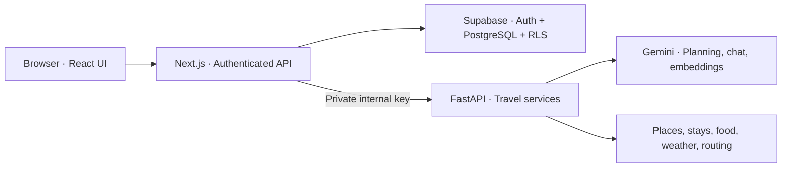
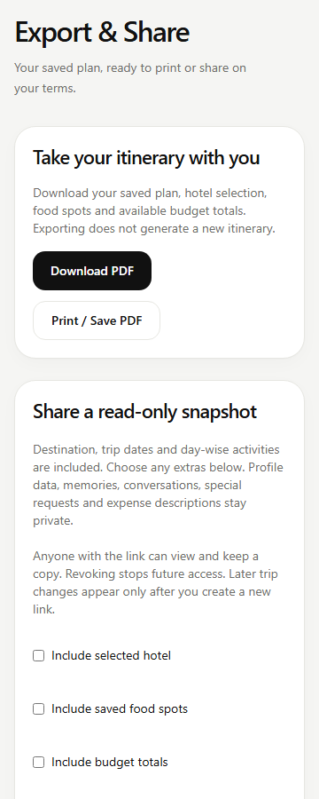

<div align="center">
  

  <h1>NomviraAI</h1>

  <p><strong>Your trip, thoughtfully planned.</strong></p>
  <p>An AI travel planner that brings destination discovery, personalized itineraries,<br />budgets, weather, and walking routes into one workspace.</p>

  <p>
    
    
    
    
    
  </p>

  <p>
    <a href="#features">Features</a> &middot;
    <a href="#architecture">Architecture</a> &middot;
    <a href="#getting-started">Getting started</a> &middot;
    <a href="#validation">Validation</a> &middot;
    <a href="#documentation">Documentation</a>
  </p>
</div>

---

## Overview

Planning a trip often means switching between maps, accommodation searches, weather forecasts, spreadsheets, and chat. NomviraAI connects those tasks around a saved trip, so the destination, dates, preferences, and budget stay consistent throughout planning.

The application combines a responsive Next.js interface, Python travel services, and a user-owned PostgreSQL data model. Gemini builds itineraries from verified place candidates, while application code handles money calculations, access control, and validation.

**Project stage:** active development. The core planning workflow has recorded live integration results; Companion, Memory, and Sharing still require database verification, and hosted deployment acceptance is pending. See [current status](#current-status).

## Features

| Capability | What it provides |
| --- | --- |
| **Trip workspace** | A seven-step creation wizard for destination, dates, travelers, budget, interests, preferences, and review; saved trip dashboards and deletion controls. |
| **Destination discovery** | Canonical destination search and nearby attractions using Open-Meteo, OpenStreetMap, and Geoapify integrations. |
| **Stays and food** | Hotel ranking, dietary and cuisine filters, a selected stay, and saved food spots, with provider attribution. |
| **AI itineraries** | Day-by-day Gemini plans grounded in discovered attractions and saved selections, with server validation and immutable version history. |
| **Budget tracking** | Decimal-safe category allocations, planned and actual expenses, remaining balances, and per-person summaries. |
| **Weather-aware planning** | Forecasts, activity conflicts, and itinerary adaptation that preserves previous versions. |
| **Maps and routes** | Interactive MapLibre maps and openrouteservice walking routes for saved itinerary activities. |
| **AI Travel Companion** | Trip-aware chat, source cards, private conversation history, and explicit confirmation before supported trip changes. |
| **Preferences and memory** | Opt-in travel defaults and consent-based memories, with private pgvector retrieval for relevant planning context. |
| **Export and sharing** | PDF downloads, a print layout, and explicitly approved read-only snapshots with expiring, revocable links. |
| **Authentication** | Supabase email/password and Google sign-in flows, session verification, and ownership checks backed by row-level security. |

Features depend on the corresponding migrations and provider configuration. Current integration limits are documented [below](#current-status).

### Planning workflow

1. **Create a trip** with your destination, dates, travelers, interests, and budget.
2. **Discover options** and save attractions, a stay, and food spots.
3. **Generate an itinerary** from the saved trip context and real place candidates.
4. **Refine the plan** using budgets, weather, walking routes, and Companion suggestions.
5. **Take it with you** as a PDF or an explicitly shared snapshot.

## Tech stack

| Layer | Technologies |
| --- | --- |
| Frontend | Next.js 16 App Router, React 19, TypeScript |
| UI and forms | Tailwind CSS 4, locally owned shadcn/ui components, Radix UI, Lucide, React Hook Form, Zod |
| Backend | Python, FastAPI, Pydantic, HTTPX, Uvicorn |
| Authentication and data | Supabase Auth, PostgreSQL, row-level security, pgvector |
| AI | Google Gemini through the Google Gen AI SDK; structured output, validated function calling, and embeddings |
| Maps and travel data | MapLibre GL, OpenFreeMap, Open-Meteo, OpenStreetMap/Overpass, Geoapify, StayAPI, openrouteservice |
| Testing | Node.js test runner, PGlite with pgvector, pytest, Ruff, ESLint, TypeScript |
| Delivery | GitHub Actions CI; deployment configuration for Vercel and Render |

## Architecture

The browser talks to authenticated Next.js routes. Next.js verifies the user, loads the owned trip, and sends trusted planning context to FastAPI. FastAPI handles provider integrations and travel calculations; Supabase stores user-owned application data.



### Engineering highlights

- **Grounded AI output.** Itinerary candidates come from trusted trip data. Server validation checks place IDs, dates, and pace before saving a version; display facts are resolved from provider records.
- **Deterministic money calculations.** Python Decimal arithmetic handles budget allocations and expense reconciliation independently of the language model.
- **Layered authorization.** Verified sessions, trip ownership, PostgreSQL RLS, and signed database operations protect persisted data. Provider credentials stay in FastAPI's private environment.
- **Controlled AI actions.** Companion proposes supported changes through validated tools. Mutations require an explicit user confirmation and server-side revalidation.
- **Consent-based personalization.** Approved preferences and memories provide retrieval context. Shared snapshots exclude private memories, conversations, and special requests.
- **Bounded provider access.** Timeouts, caches, request coalescing, rate limits, and provider failover control external calls. Structured logs, request IDs, and protected diagnostics support troubleshooting.

See the [system architecture](docs/architecture/system-architecture.md) for request flows and service boundaries.

## Getting started

### Prerequisites

- **Node.js 24** and npm, matching [`.node-version`](.node-version).
- **Python 3.13**, matching the backend CI environment.
- A **Supabase project** with Auth enabled and the project migrations applied.
- Provider credentials for the integrations you want to exercise: Gemini, StayAPI, Geoapify, and openrouteservice.

The commands below use PowerShell from the repository root. On macOS/Linux, use `python3` to create the environment and `backend/.venv/bin/python` for its executable. If PowerShell blocks the npm script wrapper, use `npm.cmd`.

### 1. Install dependencies

```powershell
npm ci
py -3.13 -m venv backend/.venv
backend/.venv/Scripts/python.exe -m pip install -r backend/requirements-dev.txt
```

### 2. Configure environment variables

Create local environment files if they do not already exist:

```powershell
if (!(Test-Path .env.local)) { Copy-Item .env.example .env.local }
if (!(Test-Path backend/.env)) { Copy-Item backend/.env.example backend/.env }
```

| File | Configuration |
| --- | --- |
| `.env.local` | `NEXT_PUBLIC_SUPABASE_URL`, `NEXT_PUBLIC_SUPABASE_PUBLISHABLE_KEY`, `NEXT_PUBLIC_SITE_URL`, `NOMVIRA_API_URL`, and `NOMVIRA_INTERNAL_API_KEY`. The map style has a default in the template. |
| `backend/.env` | The matching `NOMVIRA_INTERNAL_API_KEY`, `FRONTEND_ORIGIN`, provider selection, and private provider credentials. Use the template for model names and provider defaults. |

Generate an internal application key:

```powershell
node -e "console.log(require('node:crypto').randomBytes(32).toString('hex'))"
```

Use the **same key** in both environment files and the database configuration prepared in the next step. Keep provider keys in `backend/.env`; only browser-safe settings belong in `NEXT_PUBLIC_*` variables. Real environment files and generated setup SQL must remain private.

In Supabase Auth, configure the sign-in providers, site URL, redirect URLs, and email templates for your local application at `http://localhost:3000`.

### 3. Prepare the database

For a fresh Supabase project, first apply [`20261028000100_create_trips.sql`](supabase/migrations/20261028000100_create_trips.sql) in the SQL Editor. Existing projects should retain their migration history and data.

Then prepare the remaining supported upgrades and matching database secret:

```powershell
npm run db:prepare
```

Run the generated **private** `.qa/setup-trip-database.sql` in the matching Supabase project's SQL Editor. The command generates a local file; it does not apply changes to Supabase automatically.

Follow the [database setup and diagnosis guide](docs/setup/database.md) for schema checks and the [migration instructions](backend/README.md#database-migration-and-deployment) for more detail.

### 4. Start both services

In one terminal:

```powershell
npm run dev
```

In a second terminal, also from the repository root:

```powershell
backend/.venv/Scripts/python.exe -m uvicorn app.main:app --app-dir backend --host 127.0.0.1 --port 8001 --reload --reload-dir backend --no-access-log
```

Open the application at **http://localhost:3000**. FastAPI runs at **http://127.0.0.1:8001**; its `/health` endpoint provides a liveness check without contacting travel providers.

Provider-backed features require working credentials and matching database setup. Explicit development fixtures are available for selected integrations; production rejects fixture responses. See the [backend guide](backend/README.md) for provider modes and configuration.

## Project structure

```text
src/
  app/                    Pages, layouts, authentication, and API routes
  components/
    nomvira/              Product UI organized by travel feature
    ui/                   Shared accessible UI primitives
  lib/                    Domain logic, validation, and server orchestration
backend/
  app/
    api/                  Internal FastAPI endpoints
    core/                 Configuration, logging, limits, and monitoring
    providers/            External provider adapters
    schemas/              Pydantic request and response models
    services/             Travel services and deterministic calculations
  tests/                  Python regression tests
supabase/
  migrations/             Database schema, policies, and signed functions
  diagnostics/            Read-only database checks
tests/                    Frontend, API, and PostgreSQL regression tests
scripts/                  Database preparation and deployment checks
public/                   Branding and destination illustrations
docs/                     Architecture, setup, features, and verification
.github/workflows/        Continuous integration
```

## Validation

Run the frontend checks from the repository root:

```powershell
npm test
npm run lint
npm run typecheck
npm run build
```

Run the backend checks from `backend/`:

```powershell
.venv/Scripts/python.exe -m pytest -q
.venv/Scripts/python.exe -m ruff check app tests check_deployment.py check_live.py check_journey.py
.venv/Scripts/python.exe -m pip check
```

Feature-specific commands such as `npm run test:itineraries`, `npm run test:budget`, and `npm run test:sharing` are listed in [`package.json`](package.json).

[GitHub Actions](.github/workflows/ci.yml) runs frontend and backend checks using mocked providers and local PostgreSQL-compatible tests. Live provider probes, hosted migrations, and deployment are separate from CI. The [verification record](docs/testing/testing.md) contains the recorded results and acceptance limits.

## UI preview

<p align="center">
  
</p>

<p align="center"><em>Actual Export &amp; Share components rendered with development fixture data. This preview demonstrates the interface; live sharing acceptance is pending.</em></p>

## Current status

The [verification record dated November 10, 2026](docs/testing/testing.md) reports successful offline checks and live results for login, trip creation, attraction discovery, itinerary persistence, budgets, weather, walking routes, and export.

Remaining acceptance work includes:

- Verifying or applying the hosted database setup for Companion, Preferences/Memory, and Sharing.
- Retesting hotel and food selections after inconsistent provider responses.
- Completing email/OAuth, cross-account isolation, and full browser acceptance checks.
- Validating the deployed Vercel and Render services together with Supabase.

Explore, Saved, and Help remain placeholder pages. Provider availability and quotas affect live searches. The project includes deployment configuration; hosted release verification is pending.

## Documentation

| Guide | Contents |
| --- | --- |
| [System architecture](docs/architecture/system-architecture.md) | Service boundaries, persistence, and Companion request flow |
| [Backend setup](backend/README.md) | Python environment, provider configuration, and migrations |
| [Database setup](docs/setup/database.md) | Schema, ownership policies, and setup diagnosis |
| [AI itineraries](docs/features/ai-itinerary.md) | Grounded generation, validation, and versioning |
| [AI Travel Companion](docs/features/ai-companion.md) | Tools, confirmation flows, and security boundaries |
| [Budget engine](docs/features/budget-engine.md) | Allocations, expenses, and reconciliation |
| [Weather intelligence](docs/features/weather-intelligence.md) | Forecasts, conflicts, and itinerary adaptation |
| [Personalization and memory](docs/history/step-14.md) | Consent, preferences, and private retrieval |
| [Deployment and operations](docs/deployment/deployment.md) | Vercel/Render setup, export/sharing, and recovery |
| [Testing and verification](docs/testing/testing.md) | Recorded checks, live observations, and remaining blockers |
